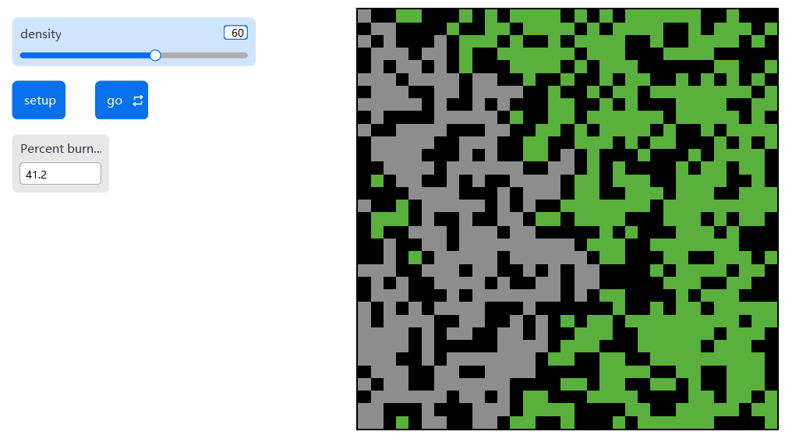

<!--
============================================================
ENVSCI 704 Assignment 2 template (fire-spread lab, Chapter 3.4)
============================================================
How to use this file:

1. In your GitHub course repo, create the folder `Assignment2/`
   and save this file there as `fire-spread.qmd`.
2. Fill in the YAML header above (your name and student ID).
3. Work through Parts A to C below. Every task needs code or a
   screenshot AND a short written answer.
4. Save screenshots as .png files in an `images/` folder next to
   this file (macOS: Cmd+Shift+4, Windows: Snipping Tool), then
   embed them like this:
       {width=70%}
5. Commit and push the .qmd AND the images/ folder, then paste
   the link on Canvas.

Tips:
- NetLogo code goes in netlogo-fenced code blocks, not Python cells.
- Give every screenshot a caption so the reader knows what it shows.
- If you build your Part B table in Excel, convert it with
  https://tabletomarkdown.com/convert-spreadsheet-to-markdown/
============================================================
-->

## Part A: Build the model

Paste your complete NetLogo code (the `globals`, `setup`, and `go` procedures):

```netlogo
globals [
  initial-trees
  burned-trees
]

to setup
  clear-all
  ask patches [
    if random 100 < density [ set pcolor green ]
  ]
  ask patches with [ pxcor = min-pxcor ] [
    if pcolor = green [ set pcolor red ]
  ]
  set initial-trees count patches with [ pcolor = green or pcolor = red ]
  set burned-trees 0
  reset-ticks
end

to go
  if not any? patches with [ pcolor = red ] [ stop ]
  ask patches with [ pcolor = red ] [
    ask neighbors4 with [ pcolor = green ] [
      set pcolor red
    ]
    set pcolor grey
    set burned-trees burned-trees + 1
  ]
  tick
end
```

**Task A1.** Embed your screenshot of the final state of the world at `density = 60`:

{width=70%}

**Task A2.** Percent burned at the end of the run: _41.2%_

## Part B: Find the critical density

**Task B1.** Complete the table: ten runs at each density, percent burned each time.

| Density | Run 1 | Run 2 | Run 3 | Run 4 | Run 5 | Run 6 | Run 7 | Run 8 | Run 9 | Run 10 | Mean |
|---:|---:|---:|---:|---:|---:|---:|---:|---:|---:|---:|---:|
| 40 | 6.5 | 15.5 | 13.1 | 4.8 | 6.4 | 8.2 | 5.0 | 11.3 | 9.7 | 4.9 | 8.54 |
| 50 | 5.0 | 5.5 | 11.1 | 9.2 | 24.3 | 20.1 | 20.8 | 10.9 | 9.1 | 15.3 | 13.13 |
| 55 | 7.2 | 24.3 | 9.5 | 36.3 | 17.9 | 17.3 | 40.8 | 65.3 | 34.3 | 14.5 | 26.76 |
| 58 | 22.1 | 50.9 | 82.7 | 33.8 | 83.4 | 72.6 | 58.8 | 7.9 | 33.0 | 87.8 | 53.30 |
| 59 | 12.8 | 62.1 | 23.0 | 74.3 | 61.1 | 90.7 | 34.0 | 61.3 | 20.3 | 74.7 | 51.43 |
| 60 | 35.6 | 92.3 | 95.2 | 31.7 | 46.3 | 34.8 | 77.9 | 32.6 | 91.9 | 84.0 | 62.23 |
| 62 | 27.4 | 74.1 | 29.4 | 76.2 | 82.7 | 77.0 | 93.3 | 89.1 | 89.0 | 63.4 | 70.16 |
| 65 | 95.6 | 93.1 | 72.1 | 94.6 | 86.3 | 66.1 | 81.3 | 97.9 | 88.4 | 92.3 | 86.77 |
| 70 | 98.4 | 96.0 | 98.5 | 97.0 | 95.9 | 98.1 | 99.0 | 96.8 | 98.2 | 95.0 | 97.29 |
| 80 | 97.7 | 98.7 | 99.7 | 99.8 | 99.9 | 99.4 | 99.8 | 99.5 | 99.4 | 99.4 | 99.33 |
**Task B2.** Plot mean percent burned vs density. By hand or Excel: embed a photo or screenshot. In Python: use the code cell below.

```{python}
#| eval: true
import matplotlib.pyplot as plt

density = [40, 50, 55, 58, 59, 60, 62, 65, 70, 80]
mean_burned = [8.54, 13.13, 26.76, 53.30, 51.43, 62.23, 70.16, 86.77, 97.29, 99.33]  

fig, ax = plt.subplots(figsize=(6, 4))
ax.plot(density, mean_burned, marker="o")
ax.set_xlabel("Density (%)")
ax.set_ylabel("Mean percent burned (%)")
ax.set_title("Percent burned vs tree density")
plt.show()
```

**Task B3 (critical-density estimate).** 
From my data, the critical density appears to be approximately 58-60%. The mean percent burned increased sharply from 26.76% at a density of 55% to 53.30% at 58%, and remained high and variable around 59-60%, reaching 62.23% at 60%. This estimated transition range is close to the theoretical critical density of about 59%.

**Task B4 (variability near the threshold).** 
At the estimated critical density of 59%, percent burned ranged from 12.8% to 90.7%, much wider than the ranges at density 40% (4.8–15.5%) and density 80% (97.7–99.9%). Variability is largest near the threshold, because the forest is close to the point where a continuous path of trees either forms or fails to form. Since tree locations are random in each run, small differences in spatial arrangement can cause the fire either to stop early or spread across most of the landscape.

## Part C: Summary ODD documentation

**The overall *purpose* of our model is** to illustrate that fire spread across a forest changes sharply around a critical tree-density threshold  due to percolation. **Specifically, we are addressing the following questions:** How does the percentage of trees burned respond to tree density? What tree density does fire spread shift sharply from limited burning to extensive burning? **To consider our model realistic enough for its purpose, we use the following *patterns*:** fire spread is limited at low tree densities, increases sharply near a critical density, and becomes extensive at high tree densities.

**The model includes the following *entities*:** patches. **The *state variables* characterising these entities are listed in Table 1.** **The *spatial* and *temporal* resolution and extent are** a 33 × 33 patch world. Each patch represents one location in the forest grid that may be empty or contain a tree, and each tick represents one fire-spread step. A run ends when no burning patches remain.

**The most important *processes* of the model, which are repeated every *time step*, are** ignition of green `neighbors4` by burning patches, followed by burnout of the currently burning patches and updating the `burned-trees` count. The tick then advances, and the model stops when no burning patches remain.

**The most important *design concepts* of the model are** emergence and stochasticity. The critical-density threshold emerges from simple fire spread between neighbouring patches. Stochasticity comes from the random placement of trees, so runs with the same density can give different results.

**The model is initialized with** trees randomly placed across the patches according to the selected `density`. Green patches on the left edge are then set on fire. `burned-trees` is set to 0 and the tick counter is reset.

**Table 1.** Entities and state variables of the model.

| Entity | Variable | Description | Possible values | Units |
|--------|----------|-------------|-----------------|-------|
| Patch  | `pcolor` |State of each patch in the forest |black = empty, green = unburned tree, red =burning tree, grey = burned tree |none |
| Global | `density` |Probability that a patch initially contains a tree |0 - 100 |% |
| Global | `initial-trees` |Number of trees present at the start of a run | non-negative integer |trees |
| Global | `burned-trees` |Number of trees that have burned during  a run  |non-negative integer |trees |


